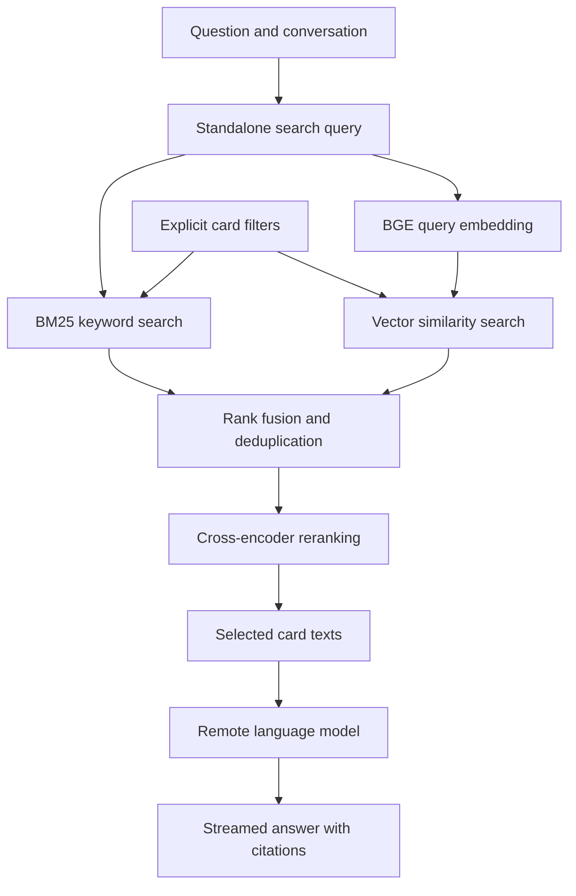

# Magic RAG

A local learning project for exploring retrieval augmented generation with **Magic: The Gathering** cards. The goal is a chat interface that finds relevant cards, explains them with citations, and lets you inspect how retrieval shaped the answer.

**Status:** architecture and repository setup. The application is not implemented yet; there are no installation or run commands available.

## What we're building

- A SvelteKit chat interface with streaming answers, conversation history, and a Stop button.
- A Python FastAPI backend for ingestion, retrieval, local models, and remote answer generation.
- One local SQLite database for card information, embeddings, conversations, and retrieval traces. No Docker or database server required.
- Hybrid search: FTS5/BM25 keyword retrieval and sqlite-vec vector retrieval, followed by reciprocal rank fusion and a cross-encoder reranker.
- A retrieval inspector showing the search query, filters, results from each search branch, fused rankings, reranking changes, and timings.
- A small benchmark comparing keyword-only, vector-only, hybrid, and hybrid-plus-reranker retrieval.

The first version focuses on **card discovery and card explanations**. Authoritative rules interactions, deck optimization, prices, and historical card wording are outside the initial scope.

## How retrieval works

During ingestion, card text and structured properties are stored alongside embeddings generated by `BAAI/bge-small-en-v1.5`. At query time, the same model embeds the search query; the database compares it with stored vectors. BM25 independently searches the text. Fusion combines the rankings, and `cross-encoder/ms-marco-MiniLM-L6-v2` scores shortlisted question-card pairs before selected card texts reach the answer model.

Both local models are starting baselines, to be measured against Magic-specific examples. The database and search algorithms do not replace these models.

## Data and model providers

The intended corpus is current canonical English text for distinct cards, collapsing repeated printings. Scryfall is the proposed source; its current export format and ingestion path still need verification. Data refreshes will be manual, versioned operations that preserve the working index if a replacement fails.

Answer generation will use a configurable remote provider. OpenCode Go is the preferred option, but [its documented coding-agent workload](https://opencode.ai/v2/docs/console/go/) leaves suitability for this application unresolved. No provider integration has been tested. Retrieval and its inspector are designed to remain useful without remote answer generation.

Card data, model downloads, local databases, and credentials are kept outside Git. This repository contains project materials, not a bundled card dataset.

## Project documentation

- [Design and accepted decisions](docs/design.md)
- [Domain glossary](GLOSSARY.md)
- [Architecture decision records](docs/adr/)
- [GitHub issue workflow](docs/workflow.md)

## Work tracking

Work is tracked in [GitHub Issues](https://github.com/George713/magic-rag/issues), following a workflow inspired by [Matt Pocock's engineering skills](https://github.com/mattpocock/skills): clarify the design, capture a spec, split it into small demonstrable issues with explicit dependencies, and implement one focused slice at a time.

Magic: The Gathering is a trademark of Wizards of the Coast. This is an independent learning project.
