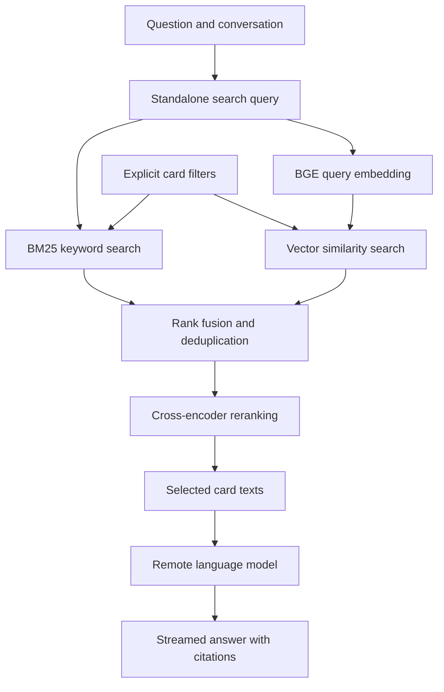

# Magic RAG

A local learning project for exploring retrieval augmented generation with **Magic: The Gathering** cards. The goal is a chat interface that finds relevant cards, explains them with citations, and lets you inspect how retrieval shaped the answer.

**Status:** the local retrieval, saved-chat, streaming, and evaluation workflows are implemented. [Windows setup, startup, and verification](docs/running.md). Remote generation is optional; OpenCode Go workload suitability and live-provider verification remain unresolved.

## Available workflows

- A dark SvelteKit conversation workspace with complete transcripts, automatic streamed answers, chat history, Stop, and Copy answer.
- A Python FastAPI backend for ingestion, retrieval, local models, and remote answer generation.
- One local SQLite database for card information, embeddings, conversations, and retrieval traces. No Docker or database server required.
- Hybrid search: FTS5/BM25 keyword retrieval and sqlite-vec vector retrieval, followed by reciprocal rank fusion and a cross-encoder reranker.
- Expandable retrieval details beneath each answer showing its query, recorded filters, search branches, fused rankings, reranking changes, and timings.
- Source-backed card images, both supplied faces, centered image previews, and optional model-selected card assets alongside answer text.
- A small benchmark comparing keyword-only, vector-only, hybrid, and hybrid-plus-reranker retrieval.
- Manual, versioned Scryfall imports that retain every card face and preserve the working corpus if a refresh fails.
- Independent persistent filters per chat for exact colors, card types, mana value, and Legendary, plus contextual rewriting with a visible submitted-text fallback when unavailable.

The first version focuses on **card discovery and card explanations**. Authoritative rules interactions, deck optimization, prices, and historical card wording are outside the initial scope.

## How retrieval works

During ingestion, card text and structured properties are stored alongside embeddings generated by `BAAI/bge-small-en-v1.5`. At query time, the same model embeds the search query; the database compares it with stored vectors. BM25 independently searches the text. Fusion combines the rankings, and `cross-encoder/ms-marco-MiniLM-L6-v2` scores shortlisted question-card pairs before selected card texts reach the answer model.

Both local models are replaceable baselines. The [benchmark](docs/evaluation.md) measures them against reviewed Magic examples; its bounded relevance judgments do not establish universal quality or latency guarantees.

## Data and model providers

The corpus uses current canonical English information for distinct cards, collapsing repeated printings and retaining all faces. Scryfall's compressed JSONL export contract is verified. [Manual imports](docs/corpus-import.md) prepare embeddings and indexes before atomically activating a replacement corpus. Token-budgeted windows preserve long card documents without silently dropping abilities.

Answer generation uses a configurable server-side provider adapter, verified with deterministic provider and HTTP-transport tests. OpenCode Go is preferred, but [its documented coding-agent workload](https://opencode.ai/v2/docs/console/go/) leaves suitability for this application unresolved. No live-provider smoke test has run and no paid alternative is selected. Requests require explicit workload confirmation and credentials. Retrieval, saved evidence, and the inspector work without a remote provider.

Card data, model downloads, local databases, and credentials are kept outside Git. This repository contains project materials, not a bundled card dataset.

## Project documentation

- [Windows setup and verification](docs/running.md)
- [Complete corpus imports and long documents](docs/corpus-import.md)
- [Vector search](docs/vector-search.md), [rank fusion](docs/hybrid-search.md), and [reranking](docs/reranking.md)
- [Exact filters](docs/filters.md) and [saved conversations](docs/conversations.md)
- [Conversational workspace and verification](docs/chat-workspace.md)
- [Provider configuration](docs/providers.md), [streaming and Stop](docs/streaming.md), and [follow-up rewriting](docs/conversational-queries.md)
- [Reviewed benchmark, metrics, and reports](docs/evaluation.md)
- [Design and accepted decisions](docs/design.md)
- [Domain glossary](GLOSSARY.md)
- [Architecture decision records](docs/adr/)
- [GitHub issue workflow](docs/workflow.md)

## Work tracking

Work is tracked in [GitHub Issues](https://github.com/George713/magic-rag/issues), following a workflow inspired by [Matt Pocock's engineering skills](https://github.com/mattpocock/skills): clarify the design, capture a spec, split it into small demonstrable issues with explicit dependencies, and implement one focused slice at a time.

Magic: The Gathering is a trademark of Wizards of the Coast. This is an independent learning project.
