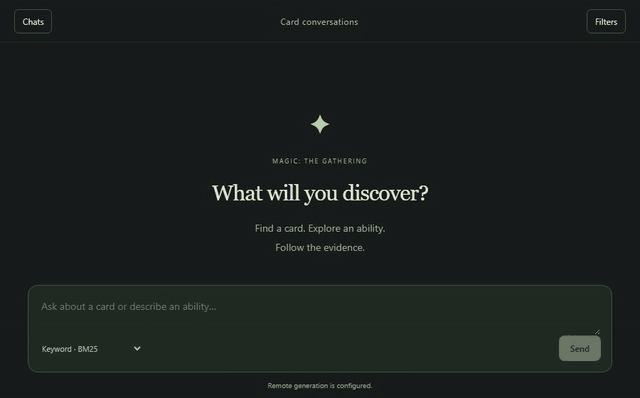
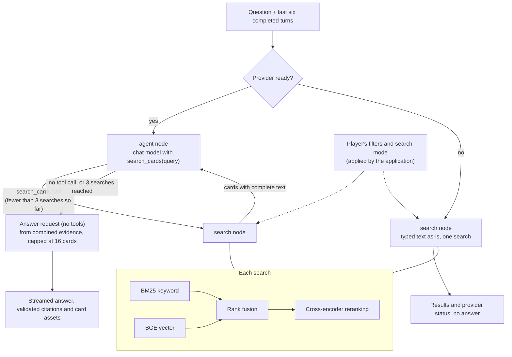

# Magic RAG

A local learning project for exploring retrieval augmented generation with **Magic: The Gathering** cards. The goal is a chat interface that finds relevant cards, explains them with citations, and lets you inspect how retrieval shaped the answer.

**Status:** the local retrieval, card-search agent, saved-chat, streaming, and evaluation workflows are implemented. [Windows setup, startup, and verification](docs/running.md). Remote generation is optional. OpenCode Go's workload suitability is the maintainer's own decision, and live provider checks are recorded separately from the deterministic test suite in the [provider guide](docs/providers.md).

## Available workflows

- A dark SvelteKit conversation workspace with complete transcripts, automatic streamed answers, chat history, Stop, and Copy answer.
- A Python FastAPI backend for ingestion, retrieval, local models, and remote answer generation.
- One local SQLite database for card information, embeddings, conversations, and retrieval traces. No Docker or database server required.
- Hybrid search: FTS5/BM25 keyword retrieval and sqlite-vec vector retrieval, followed by reciprocal rank fusion and a cross-encoder reranker.
- A card-search agent that writes up to three searches per message, with live search lines that fold into an expandable "N searches" summary showing each search's query, recorded filters, search branches, fused rankings, reranking changes, and timings.
- Source-backed card images, both supplied faces, centered image previews, and optional model-selected card assets alongside answer text.
- A small benchmark comparing keyword-only, vector-only, hybrid, and hybrid-plus-reranker retrieval.
- Manual, versioned Scryfall imports that retain every card face and preserve the working corpus if a refresh fails.
- Independent persistent filters per chat for exact colors, card types, mana value, and Legendary, which apply to every search the agent makes. Without a provider, the typed text is searched as-is.

The first version focuses on **card discovery and card explanations**. Authoritative rules interactions, deck optimization, prices, and historical card wording are outside the initial scope.

## How the agent searches

_Recorded with Playwright against the browser-test fixture: real FastAPI and SvelteKit processes and a deterministic scripted chat model, slowed down so each step is visible. No live provider was involved._

Each message runs one hand-built [LangGraph](https://langchain-ai.github.io/langgraph/) agent graph ([ADR 0005](docs/adr/0005-hand-built-agent-graph-with-a-search-limit.md)). The model writes its own card searches, starting with the first message of a conversation. It can search up to three times, for example to retry weak wording or to look up each card being compared, and then answers from all the cards it found.

The model only chooses query strings. The application applies the player's explicit filters and chosen search mode (keyword, vector, hybrid, or hybrid with reranking) to every search, and the model can neither see nor change them. The answer's evidence is the deduplicated union of all searches' cards, taken by rank across searches and capped at twice the per-search evidence limit (16 cards by default). Citations and card assets must reference that evidence. While the agent works, the chat shows a live `searching "<query>" · N cards` line for each search. When the answer is complete, the lines fold into an "N searches" summary that opens the retrieval details for every search. Stop ends the run and removes the message.

During ingestion, card text and structured properties are stored alongside embeddings generated by `BAAI/bge-small-en-v1.5`. At query time, the same model embeds each search query, and the database compares it with stored vectors. BM25 independently searches the text. Fusion combines the rankings, and `cross-encoder/ms-marco-MiniLM-L6-v2` scores shortlisted query-card pairs before the selected card texts return to the agent.

Both local models are replaceable baselines. The [benchmark](docs/evaluation.md) measures them against reviewed Magic examples; its bounded relevance judgments do not establish universal quality or latency guarantees.

## Data and model providers

The corpus uses current canonical English information for distinct cards, collapsing repeated printings and retaining all faces. Scryfall's compressed JSONL export contract is verified. [Manual imports](docs/corpus-import.md) prepare embeddings and indexes before atomically activating a replacement corpus. Token-budgeted windows preserve long card documents without silently dropping abilities.

The agent's searches and answers run through LangChain's OpenAI-compatible chat model, configured server-side. Automated tests substitute a deterministic scripted chat model and never call a remote model. OpenCode Go is preferred, but [its documented coding-agent workload](https://opencode.ai/v2/docs/console/go/) leaves suitability for this application unresolved; the maintainer confirms it locally. Live tool-calling, agent, and multi-search runs are recorded in the [provider guide](docs/providers.md) as dated manual checks, separate from the automated tests. No paid alternative is selected. Requests require explicit workload confirmation and credentials. Retrieval, saved evidence, and the inspector work without a remote provider.

Card data, model downloads, local databases, and credentials are kept outside Git. This repository contains project materials, not a bundled card dataset.

## Project documentation

- [Windows setup and verification](docs/running.md)
- [Complete corpus imports and long documents](docs/corpus-import.md)
- [Vector search](docs/vector-search.md), [rank fusion](docs/hybrid-search.md), and [reranking](docs/reranking.md)
- [Exact filters](docs/filters.md) and [saved conversations](docs/conversations.md)
- [Conversational workspace and verification](docs/chat-workspace.md)
- [Provider configuration](docs/providers.md), [streaming and Stop](docs/streaming.md), and [agent-written searches and follow-ups](docs/conversational-queries.md)
- [Reviewed benchmark, metrics, and reports](docs/evaluation.md)
- [Design and accepted decisions](docs/design.md)
- [Domain glossary](GLOSSARY.md)
- [Architecture decision records](docs/adr/)
- [GitHub issue workflow](docs/workflow.md)

## Work tracking

Work is tracked in [GitHub Issues](https://github.com/George713/magic-rag/issues), following a workflow inspired by [Matt Pocock's engineering skills](https://github.com/mattpocock/skills): clarify the design, capture a spec, split it into small demonstrable issues with explicit dependencies, and implement one focused slice at a time.

Magic: The Gathering is a trademark of Wizards of the Coast. This is an independent learning project.
